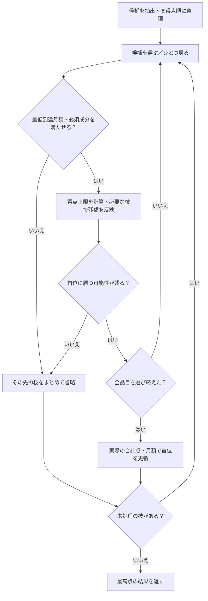

# 採点・組み合わせ探索・進捗表示の計算方法

更新日：2026-11-22 ／ 実装：v0.9.18

女性版と男性版は商品DBを分け、同じ[選定エンジン](../dist/optimizer.js)を使う。この文書は実装済みの方法を記録する。商品ごとの元点の根拠は[採点基準](../catalog/scoring.md)と各DBの `scores.csv` を参照する。

## 1. 月額費用

```text
商品月額 = round(購入価格 ÷ 使い切り回数 × 1日使用回数 × 30)
組み合わせ月額 = 各商品の月額の合計
```

各商品の月額を円単位に四捨五入してから合計する。JAN一致の小売価格・使用量を結合した後の値を使い、購入価格・使用量・使用回数・頻度の手動補正も反映する。予算は上限制約であり、安さを適合点に加算しない。

## 2. 組み合わせ全体の採点

肌悩みごとに、採用商品の元点を高い順に並べ、上位3品を計算する。

```text
悩み別加点 = (1位の元点 × 7 + 2位 × 3 + 3位 × 1) × 悩みの優先度
優先度：最優先 1.6 ／ 気になる 1 ／ 軽く気になる 0.55
```

選択したすべての肌悩みの加点を足す。同じ悩みに対応する商品も2品目・3品目は小さく加点され、4品目以降はその悩みでは加点されない。対応の重複を一律0点にはしない。元点の0〜3点と、倍率適用後の評価点を区別する。

例：乾燥・シミが通常優先度で、その他の加点がない場合。

| 商品 | 乾燥の元点 | シミの元点 | 単品の評価点 | 乾燥3点の保湿と組んだ評価点 |
| --- | ---: | ---: | ---: | ---: |
| 洗顔C | 3 | 0 | 21 | 30 |
| 洗顔D | 0 | 2 | 14 | 35 |

単品では低いDが、重複の少ない組み合わせでは勝つ。このため、最初に予算内の組み合わせができた時点では止めない。

| その他の項目 | 計算 |
| --- | --- |
| 追加ステップ | 化粧水・美容液・目元ケア、およびメイク落とし使用時の追加洗顔について、1品あたり手軽に5点／こだわらない2点／しっかり0点を減点 |
| 乾燥肌 | 採用商品の乾燥の最高元点 × 1.8 |
| 脂性肌 | 採用商品のベタつきの最高元点 × 1.8 |
| 混合肌 | 乾燥の最高元点とベタつきの最高元点の合計 × 0.9 |
| 敏感肌の希望 | `sensitiveSkin` が付いた商品1品につき3点 |
| 使用感の希望 | 指定した使用感と一致する化粧水・保湿1品につき2点 |
| 使ってみたい成分 | 指定成分を含む商品が1品以上あれば合計10点。該当商品の数では増やさない |
| 成分の種類 | 主要成分名の重複を除いた種類数 × 0.25。12種類・3点まで |
| 配合量の情報公開 | 出典付きの配合量が登録された商品の割合 × 1.05。最大1.05点 |

肌悩みが未選択なら提案を行わない。計算は `explainRoutineScore` に従い、各内訳を小数点以下2桁に丸めてから小計・合計を求める。

## 3. 候補の抽出と探索順

固定・除外・用途の条件を適用する。化粧水・美容液などの任意追加品は、選択した肌悩みへの点数、指定成分、または商品の固定がある場合に候補へ入る。目元ケアは「目元の乾燥」を選んだ場合だけ任意追加する。

メイク落としを使わないときは洗顔を含める。メイク落としを使う場合、洗顔を省略できるのはW洗顔不要の商品を選んだとき。手軽さ重視では、洗顔の固定がなければ追加洗顔を省略する条件で探索する。

通常の首位探索（`resultLimit: 1`）は、次の順で深さ優先に調べる。

```text
メイク落とし → 洗顔 → 保湿 → 化粧水 → 美容液 → 目元ケア
```

**各品目内は、省略できる品目も含め、手間点などを反映した単品評価の高い順に並べる。** 省略する選択肢は空の組み合わせ・0点として比較する。追加すると減点が勝つ商品は、省略より後に試す。

これは探索順を決める方法であり、完成した組み合わせ全体を得点順に列挙する方法ではない。完成した組み合わせの優先順位は次のとおり。

1. 組み合わせ全体の評価点が高い。
2. 同点なら月額が安い。
3. 点数と月額が同じなら、元の品目順・DB候補順で先の組み合わせ。

探索順を並べ替えても、完全同点時の判定には元の候補位置を使う。

## 4. 最高点を逃さずに探索を省略する条件

一部の商品を選んだ状態を「固定済み」、これから選ぶ品目を「残り」と呼ぶ。探索で暫定首位が更新されるたび、その得点・費用と比較する。

### 費用・必須成分

```text
最低到達月額 = 固定済み月額 + 残りの各品目の最安月額の合計
```

最低到達月額が予算を超えれば、その先はすべて省略できる。必須成分を固定済み商品が含まず、残りの候補にも存在しない場合も省略する。

### 得点の楽観的な上限

固定済み商品の実際の点数と、残りの各品目の肌悩み別最高点を使って、7・3・1倍の計算をする。その他の加点は最大限有利に、残りの手間点は最小に見積もる。

同じ品目の別商品から最高点・最安費用などを取ることもあるため、この値は実際に到達できる点数より高い場合がある。高めの上限は探索量を増やすが、最高点を取り逃がす省略にはつながらない。

```text
得点上限 < 暫定首位の得点
または
得点上限 = 暫定首位の得点、かつ、最低到達月額 > 暫定首位の月額
```

このどちらかなら枝を省略する。同点・同額になれる枝は、元の候補順で勝つ可能性があるため残す。

### v0.9.18：残り予算を反映した上限の再確認

上の安価な判定で残った枝について、有限の予算かつ残りが2品目以上の場合に、肌悩みの上限をさらに絞る。

```text
品目gの上限予算 = 総予算 − 固定済み月額
                  − 品目g以外の残りを最安で揃える月額
```

この金額以下で買える候補だけから、品目 `g` の肌悩み別最高点を求める。他の残り品目でも同じことを行い、肌悩み加点の上限を計算し直す。

```text
新しい得点上限 = 従来の得点上限
                 − 従来の肌悩み加点上限
                 + 買える候補で計算した肌悩み加点上限
```

肌質・敏感肌・使用感・成分・情報公開など、その他の加点は従来の楽観的な上限を保つ。各品目の最安費用を差し引いても購入できない商品は、どの予算内の完成形にも入らないため、上限の候補から外しても最高点を逃さない。上限の計算にも採点と同じ倍率・優先度・丸めを適用する。

例：残額1,000円では月額3,329円の美容液を使えない。その美容液の高得点を前提に「まだ首位に勝てる」と判断して探索を続けることを避ける。

**組み合わせの計算結果を保存・再利用するキャッシュは使用しない。** 候補と各品目の最大値・最小値は、その検索時の条件・価格補正に従って作り直す。

### 終了条件

最初の予算内の完成形、または最初の高得点候補で停止しない。すべての枝を調べるか、上の条件で安全に省略したときに終了する。単品の評価点が低いという理由だけで、後続の商品を一括除外しない。



## 5. 最低予算の探索

予算内に提案がない場合、Workerは予算上限を外し、`objective: 'minimumMonthly'` で最低必要月額を一度探索する。これは最大得点の探索とは別の経路である。

現行の最低予算探索はDB順の深さ優先で、途中の費用が既知の最小月額以上なら枝を省略する。月額の安い順への並べ替えは、この版では未実装。通常の首位探索の高得点順とは区別する。

## 6. 進捗率と工程表示

探索の100%は、用途・固定・除外などで抽出した候補の直積を全探索した場合の組み合わせ数。省略する選択肢も1候補として数える。

```text
進捗率 = floor((採点済み件数 + 省略済み件数) × 10000 ÷ 全候補数) ÷ 100
```

件数はBigIntで扱う。枝を省略したときは、その先の候補数の積をまとめて処理済みに加える。単品で予算を超える候補の除去も差分で加算し、完了時は採点済み＋省略済み＝全候補数になることを検査する。

進捗率は小数点以下2桁で表示し、先頭空白を含む7文字を保つ。CSSは等幅フォント・幅7ch・空白保持を指定する。

```text
  9.00%
 99.00%
100.00%
```

探索中の工程名は、実際に比較している品目に応じて「洗顔の暫定一位を計算しています……」「乳液・クリームなどと組み合わせています……」「美容液と組み合わせています……」などに切り替える。文章の変更は1秒以上空けるが、進捗率の通知は約50ms間隔で続ける。完了通知と結果への移行は待たせない。0.3秒で計算が終われば、1秒待たずに結果へ進む。

カタログ読み込みは4ファイルの完了数、照合は5工程の完了数を使う。予算不足で最低予算を調べる場合は、別工程へ移ったことを明示する。Workerを使い、条件変更時には以前のWorkerを終了して、その結果や進捗を表示しない。

## 7. 検証と変更時の注意

```sh
npm test
npm run search:verify
```

`npm test` は男女のDB照合と通常の回帰テストを実行する。`search:verify` は固定乱数の合成データ360条件と、男女の実商品を絞った36条件で、枝刈りする探索と全探索の結果が商品・得点・費用まで一致することを確認する。進捗の件数一致も検査する。全探索が必要なため、検証用データの品数は小さく保つ。

採点式や候補条件を変更した場合は、得点上限・費用下限・同点判定も合わせて確認する。新しい正の加点を上限から漏らすと、最適解を省略するおそれがある。手間点・成分の重複・価格補正・必須成分・固定・除外・W洗顔条件・端数処理・同点時の価格を含めて全探索と比較する。

実データの時間測定では、乾燥＋目元の乾燥、月予算5,000円、手間「こだわらない」の検索が、比較元の約2.07秒から約0.50秒へ短縮した。同じNode.js実行環境で、1回ウォームアップ後に3回測った中央値であり、読み込み・描画・スマホ実機の時間は含まない。比較元は全品目を高得点順にする修正を含むため、得点上限の修正の効果を比較している。短い処理や別の条件では追加判定の負荷が上回る場合もあり、すべての条件での高速化を保証するものではない。
